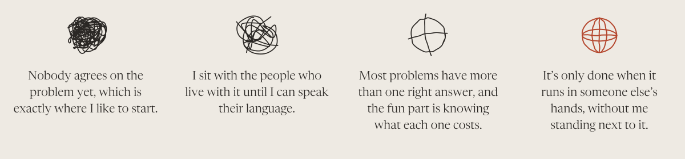

<picture>
  <source media="(prefers-color-scheme: dark)" srcset="assets/banner-dark.svg">
  
</picture>

 

I'm Luana, and I've ended up working in pretty different places, from credit to public health, always arriving without really knowing the field, which turned out to be the part I like most, because there's a moment a few weeks in when what was confusing finally has enough shape for someone to disagree with a decision of mine. Most of that habit comes from engineering at Poli-USP, where studying materials, metallurgy and nuclear taught me to understand how the parts of a system push on each other before drawing anything that has to survive outside the paper, and these days I put it to work in data and applied AI, here in São Paulo, roughly like this:

<picture>
  <source media="(prefers-color-scheme: dark)" srcset="assets/method-dark.svg">
  
</picture>

 

If that's the kind of problem you have on your hands, come talk to me :)

luana.megso@gmail.com · [LinkedIn](https://www.linkedin.com/in/luanagomesd) · [luagk.dev](https://luagk.dev)

 

<picture>
  <source media="(prefers-color-scheme: dark)" srcset="assets/stack-dark.svg">
  
</picture>

*Python, SQL, PySpark, GCP, AWS, Azure, Metabase, Power BI, LLM agents, RAG and MCP*

Made in São Paulo
